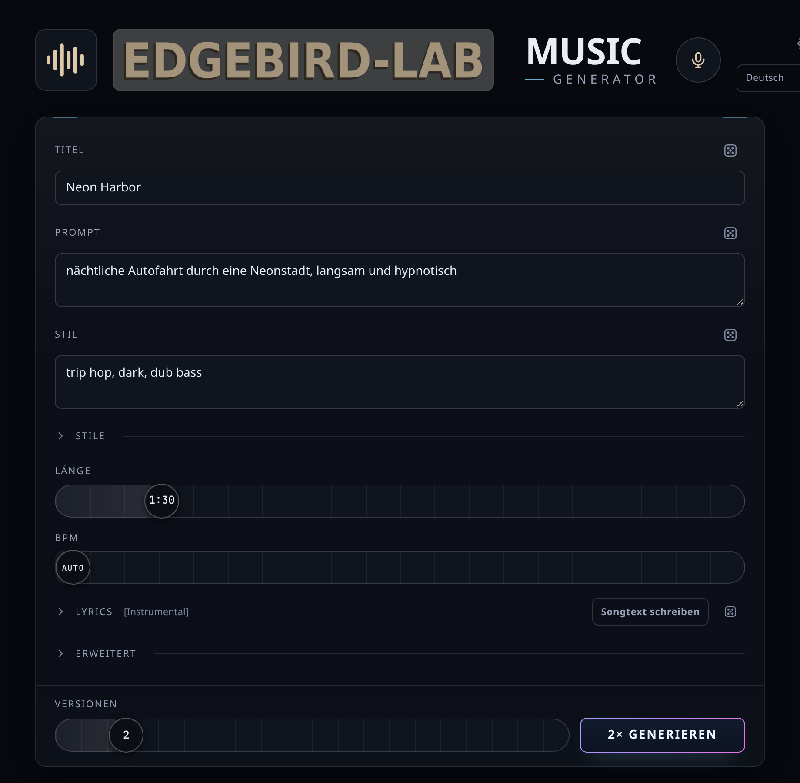

# Music Generator · EdgeBird-Lab

**Eigene Songs komplett lokal erzeugen: Musik, Songtext, Gesang und Abmischung auf dem eigenen Rechner. Ohne Cloud, ohne Abo, ohne Limits.**

*English summary: a local-first AI music studio. It generates full songs with [ACE-Step 1.5](https://github.com/ace-step/ACE-Step-1.5) through [acestep.cpp](https://github.com/ServeurpersoCom/acestep.cpp), writes lyrics with a local Ollama model (normal or unfiltered), and ships a small multitrack Studio: vocal/beat separation (Demucs), new vocal takes over any beat, voice conversion with your own trained voice (Applio/RVC), effects, recording and export. Linux installer with hardware detection: `bash <(curl -fsSL https://raw.githubusercontent.com/edgebird-lab/music-generator/main/bootstrap.sh)`. The UI speaks twelve languages.*

<p align="center"></p>

## Was die App kann

| Bereich | Das steckt drin |
|---|---|
| **Generator** | Prompt, Stil (Karten und Würfel), Länge 10 s bis 10 Minuten, Tempo, Tonart, Takt, Seed, mehrere Versionen auf einmal. Lyrics selbst schreiben, vom Songtexter holen oder automatisch schreiben lassen. Songs analysieren (Datei hochladen) oder eine Idee ins Mikrofon summen: Beschreibung, Tempo und Tonart werden übernommen. **Stimme verwenden:** die Klangfarbe eines früheren Songs für neue Songs übernehmen. |
| **Songtexter** | Schreibt mit einem lokalen Ollama-Modell komplette Songtexte: über 100 Genres mit eigenen Schreibregeln, Stimmung, Aufbau per Drag-and-drop, Perspektive, Reimschema, Überarbeiten und einzelne Abschnitte neu schreiben. Zwei Betriebsarten: **Normal** (jugendfrei, jedes Modell) und **Ohne Filter** (unzensierte Modelle, vier Härtegrade). Das Modell ist frei wählbar. |
| **Studio** | Mehrspur-Editor im Browser: Schneiden, Verschieben, Kopieren, Blenden, Raster am gemessenen Tempo, Schleife, Bereich herausschneiden, Übersichtsleiste zum Springen im Song. **Gesang und Beat trennen** (Demucs, 2 oder 4 Spuren). **Neue Stimme:** einen Text über einen vorhandenen Beat singen lassen, taktgenau angelegt. **Meine Stimme:** aus 10 bis 20 Minuten eigener Aufnahme ein Stimm-Modell trainieren (Applio/RVC) und jeden Gesang in die eigene Stimme umwandeln. Effekte je Spur (EQ, Kompressor, Hall, Echo im Takt), Mikrofonaufnahme mit Latenzausgleich, Import eigener Dateien, Export in die Bibliothek. |
| **Bibliothek** | Ordner, Favoriten, Suche, Umbenennen, Varianten (A, B, C …), WAV oder MP3, ZIP-Download, Lyrics des Modells als Text, Höhen ausgleichen (gegen den dumpfen Klang des Decoders). |
| **Allgemein** | Zwölf Sprachen, Screenreader-Beschriftung und Tastenkürzel, Update in der App direkt von den [Veröffentlichungen auf GitHub](https://github.com/edgebird-lab/music-generator/releases). Alles läuft auf `localhost`, nichts verlässt den Rechner. |

Mehr dazu, auch warum es diese App gibt: [docs/UEBER-DIE-APP.md](docs/UEBER-DIE-APP.md).

## Installation unter Linux (ein Befehl)

```bash
bash <(curl -fsSL https://raw.githubusercontent.com/edgebird-lab/music-generator/main/bootstrap.sh)
```

Das holt die neueste Veröffentlichung nach `~/MusicGenerator` und startet `install.sh`. Wer lieber selbst klont:

```bash
git clone https://github.com/edgebird-lab/music-generator.git ~/MusicGenerator
cd ~/MusicGenerator && ./install.sh
```

`./install.sh --dry-run` zeigt vorher, was passieren würde, ohne etwas zu verändern. Der Installer

1. **prüft den Rechner:** Distribution, Grafikkarte, Grafikspeicher, Arbeitsspeicher, freien Platz,
2. **wählt das Backend:** Vulkan (AMD, Intel, NVIDIA; bewährt auf einer Radeon RX 7900 XTX), CUDA bei NVIDIA mit Toolkit, ROCm auf Wunsch (`--backend rocm`), sonst CPU,
3. **stellt die bestmögliche Modellkombination zusammen** (Tabelle unten) und zeigt sie zur Bestätigung,
4. **installiert nacheinander alles, was fehlt:** Compiler, cmake, Vulkan-Entwicklungspakete, `uv` und die Python-Pakete der App,
5. **baut den Modellserver** acestep.cpp in der getesteten Version (`b7ba6d9`),
6. **lädt die Modelle** von Hugging Face, fortsetzbar und mit SHA-256-Prüfung,
7. **testet das Sprachmodell** auf der Grafikkarte (sonst rechnet es auf dem Prozessor) und schreibt `data/engine.conf`,
8. **richtet Ollama ein** (offizielles Skript, nach Rückfrage) und lädt die beiden Textmodelle für den Songtexter,
9. **bereitet die Spurtrennung vor** (Demucs mit Torch für den Prozessor, etwa 1 GB) und auf Wunsch **Meine Stimme** (`--full`, Applio mit PyTorch für ROCm oder CUDA, etwa 17 GB),
10. **legt den Befehl `musik` und einen Menüeintrag an** und startet die App unter http://localhost:8765.

Er kann jederzeit erneut laufen, Erledigtes wird übersprungen. Optionen: `--yes`, `--backend auto|vulkan|rocm|cuda|cpu`, `--lm 0.6B|1.7B|4B`, `--xl`, `--no-xl`, `--xl-bf16`, `--full`, `--no-ollama`, `--no-stems`, `--no-start`, `--start`, `--stop`, `--status`, `--uninstall`. Getestet auf Ubuntu 26.04 (apt); vorgesehen für Debian und Linux Mint (apt), Arch, CachyOS, EndeavourOS und Manjaro (pacman), Fedora (dnf) und openSUSE (zypper), die beiden letzten ungetestet.

### Welche Modelle der Installer wählt

Der Grafikspeicher entscheidet. Ohne eigene Grafikkarte zählt der Arbeitsspeicher, und alles rechnet auf dem Prozessor (langsam, aber es geht).

| Grafikspeicher | ACE-Step Sprachmodell | Klangmodelle | Songtexter Normal | Songtexter Ohne Filter |
|---|---|---|---|---|
| ab 20 GB | 4B (4,5 GB) | SFT + XL + XL BF16 (10 GB) | `gemma4:26b` (17 GB) | `orcarouter/Qwen3.8-27B-Uncensored:q3_k_m` (14 GB) |
| 12 bis 19 GB | 4B | SFT + XL (5,3 GB) | `gemma4:12b` (8 GB) | `huihui_ai/qwen3-abliterated:14b` (9 GB) |
| 8 bis 11 GB | 4B | SFT | `gemma4:e4b` (7 GB) | `huihui_ai/qwen3-abliterated:8b` (5 GB) |
| 6 bis 7 GB | 1.7B (2 GB) | SFT, Decoder in Kacheln | `gemma4:e2b` (5 GB) | `huihui_ai/qwen3-abliterated:4b` (3 GB) |
| unter 6 GB | 0.6B (0,7 GB) | SFT, kleine Kacheln | keiner | keiner |

Die Modelle für den Songtexter laden nur, solange geschrieben wird, und werden vor jedem Song wieder entladen. Reicht der Grafikspeicher nicht für beide auf einmal, lagert Ollama einen Teil in den Arbeitsspeicher aus. Die beiden großen Textmodelle sind auf einer RX 7900 XTX mit 24 GB im Alltag erprobt, die kleineren Stufen sind Empfehlungen nach Größe. In der App lässt sich jedes installierte Ollama-Modell wählen (Songtexter › Modell, Zahnrad › Texter).

## Mac und Windows

Die Installer aus dem Ursprungsprojekt sind enthalten und laden Generator, Bibliothek und Songtexter-Oberfläche: **Mac** mit Apple Silicon über `Mac-Install.command` (fertige Programmdateien ab macOS 26, sonst wird kompiliert), **Windows** mit NVIDIA über `Windows-Install.bat` (siehe [README-WINDOWS.md](README-WINDOWS.md)). Für den Songtexter dort [Ollama](https://ollama.com) installieren und ein Modell laden (`ollama pull gemma4:12b`). Die Spurtrennung im Studio richtet sich beim ersten Gebrauch selbst ein. **Meine Stimme** (Applio) gibt es bisher nur unter Linux.

## Benutzen

- `musik start` startet Modellserver, Ollama und die Web-App und öffnet http://localhost:8765 (`musik stop`, `musik neustart`, `musik status`; alternativ `./install.sh --start`, `Music Generator ON.sh` oder der Menüeintrag).
- **Generator:** Prompt und Stil eingeben oder würfeln, Länge wählen, **Generieren**. Unter jedem Song stehen Tempo, Tonart, Iterationen (IT) und Varianz (VAR). Mit dem Mikrofon-Knopf oben eine Idee summen, mit dem Logo einen Song zur Analyse hochladen.
- **Songtexter** (Knopf „Songtext schreiben“ bei den Lyrics): Betriebsart und Modell oben wählen, Thema eingeben, Genre und Stimmung anklicken, schreiben lassen, überarbeiten, **In den Song übernehmen**. Die Länge des Songs wird aus dem Text geschätzt.
- **Studio** (Knopf oben rechts oder das Studio-Symbol an einem Song): Songs aus der Bibliothek auf Spuren ziehen, Clips schneiden, **Gesang und Beat trennen**, mit **Neue Stimme** einen anderen Text über den Beat singen lassen, mit **Meine Stimme** den Gesang in die eigene Stimme umwandeln, Effekte setzen, **In die Bibliothek** exportieren. Die Leiste ganz unten zeigt den ganzen Song: Klicken oder Ziehen springt an die Stelle, auch während der Wiedergabe; Pfeiltasten springen 1 s, mit Umschalt 10 s.
- **Tastenkürzel:** Generator Alt+G generieren, Alt+R Idee aufnehmen, Alt+N zum Prompt, Alt+B zur Bibliothek, Leertaste abspielen. Studio: Leertaste, S teilen, R aufnehmen, Strg+Z/Y, Strg+C/V/D, Pos1/Ende, Pfeiltasten, + und − zoomen.
- **Einstellungen (Zahnrad):** Klangmodell (Standard, XL, XL BF16), Texter-Modell fürs automatische Schreiben, Höhen ausgleichen, Export WAV/MP3, Song-Ordner, Anordnung, Updates.

### Bedienung mit Screenreader

Jeder Knopf und Regler ist beschriftet, Regler sagen ihren Wert im Klartext, Songs sind Überschriften der Ebene 3, Ereignisse werden angesagt („Fertig: …“). Löschen und Stoppen fragen über einen zweiten Druck nach. Rückmeldungen sind willkommen.

## Aktualisieren

In der App: Zahnrad › **Nach Updates suchen** › **Jetzt aktualisieren**. Die App holt die **neueste Veröffentlichung** (GitHub-Release) dieses Repositorys, nicht irgendeinen Zwischenstand, und startet sich neu. Hat sich die Modellversion geändert, weist sie darauf hin, den Installer einmal laufen zu lassen. Von Hand: `cd ~/MusicGenerator && git fetch --force --tags && git merge --ff-only $(git tag -l 'v*' --sort=-v:refname | head -1) && ./install.sh`. Songs, Einstellungen und Studio-Projekte in `data/` bleiben erhalten.

## Deinstallieren

`./install.sh --uninstall` (Linux), `Mac-Uninstall.command`, `Windows-Uninstall.bat`. Entfernt Modellserver, Modelle, Python-Umgebungen und Einstellungen; Songs und Bibliothek bleiben auf Wunsch. Ollama und seine Modelle bleiben installiert (`ollama rm <modell>` entfernt sie).

## Aufbau

| Pfad | Inhalt |
|---|---|
| `install.sh`, `bootstrap.sh`, `musik.sh` | Linux: Installer mit Hardware-Erkennung, Ein-Zeilen-Einstieg, Startbefehl |
| `arch_linux.sh`, `ubuntu.sh`, `Linux-Install.sh`, `Music Generator ON/OFF.sh` | Linux: Start und Stopp der Server (von `install.sh` genutzt), ältere Installer |
| `Mac-Install.command`, `Music Generator ON/OFF.command`, `Mac-Uninstall.command` | Mac |
| `Windows-Install.ps1` + `.bat`, `Music Generator ON/OFF.ps1` + `.bat`, `Windows-Uninstall.ps1` + `.bat` | Windows |
| `scripts/common.sh` | gemeinsame Pfade, Ports, acestep.cpp-Version, Modell-Prüfsummen (`common.ps1` liest sie für Windows) |
| `scripts/vc_setup.sh`, `scripts/stems.py`, `scripts/metal_selftest.py`, `scripts/uninstall.sh` | Meine Stimme einrichten, Spurtrennung, Selbsttest, Deinstallation |
| `app/` | FastAPI-Backend: `main.py` (Warteschlange, Bibliothek, Einstellungen), `engines.py` (ace-server), `texter.py` + `songtexter.json` (Songtexter), `studio.py` (Studio, Demucs, Applio), `voices.py`, `klang.py` (Höhen, Stimmreferenz, Beat-Messung), `updater.py` (Releases), `messages.py` (Servermeldungen in zwölf Sprachen) |
| `static/` | Oberfläche: `index.html` + `app.js` + `texter.js`, `studio.html` + `studio.js`, `style.css` + `studio.css`, `i18n.js` |
| `docs/` | `UEBER-DIE-APP.md`, Bilder, Quelle der Installationsanleitung (`docs/anleitung`) |
| `engine/` | acestep.cpp, Modelle, Demucs- und Applio-Umgebungen (vom Installer, nicht im Repository) |
| `data/` | Songs, Datenbank, Studio-Medien, Stimm-Modelle, Logs, `engine.conf` (nicht im Repository) |

## Herkunft und Dank

Dieses Projekt ist eine eigenständige Weiterentwicklung von EdgeBird-Lab auf Basis von [music-generator](https://github.com/rabbitfiremediacreation/music-generator) von ALPHATESTER (MIT-Lizenz), der Web-Oberfläche für ACE-Step 1.5. Songtexter, Studio, Stimmen, Linux-Installer mit Hardware-Erkennung und das Update über Veröffentlichungen sind neu dazugekommen. Dank an die Beiträge zum Ursprungsprojekt, die hier weiterleben: ZeroDot1 (Arch-Installer, Deinstallation), Jano69 (Ubuntu-Installer), JUKA0920 (Höhen ausgleichen, Spitzenbegrenzung).

Bausteine: [acestep.cpp](https://github.com/ServeurpersoCom/acestep.cpp) (Modellserver, MIT), [ACE-Step 1.5](https://github.com/ace-step/ACE-Step-1.5) (Modelle, MIT laut Entwicklern; GGUF-Dateien von [Serveurperso](https://huggingface.co/Serveurperso/ACE-Step-1.5-GGUF)), [Ollama](https://ollama.com) (Textmodelle), [Demucs](https://github.com/facebookresearch/demucs) (Spurtrennung, MIT), [Applio](https://github.com/IAHispano/Applio) (Stimm-Umwandlung, MIT; bitte die [Nutzungsbedingungen](https://github.com/IAHispano/Applio/blob/main/TERMS_OF_USE.md) beachten: nur die eigene Stimme oder mit Erlaubnis), [wavesurfer.js](https://github.com/katspaugh/wavesurfer.js) (BSD-3-Clause). Vor kommerzieller Nutzung die Lizenz- und Trainingsdatenlage der Modelle selbst prüfen.

## Lizenz

Der Code in diesem Repository steht unter der [MIT-Lizenz](LICENSE).
